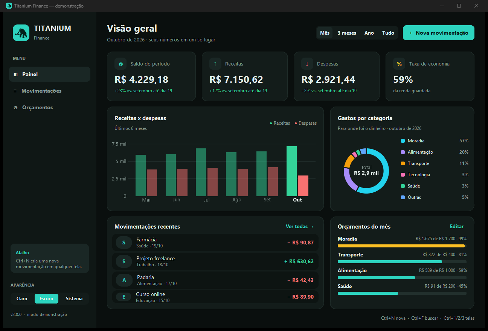
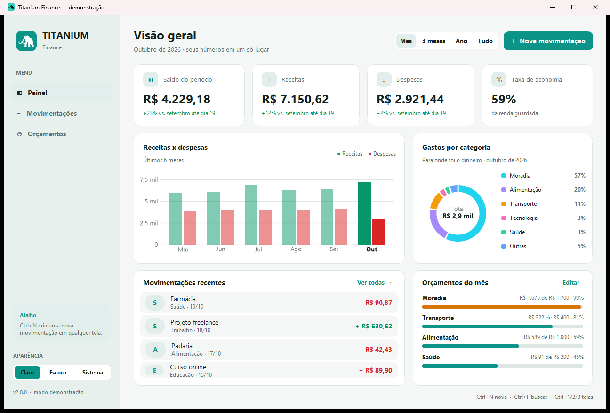
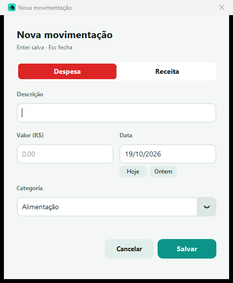
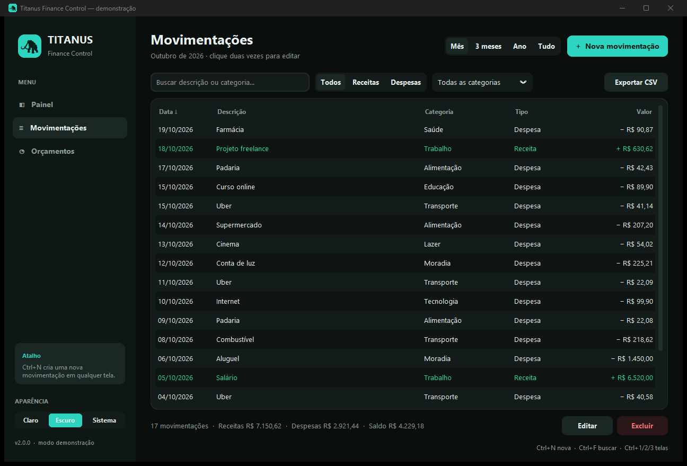
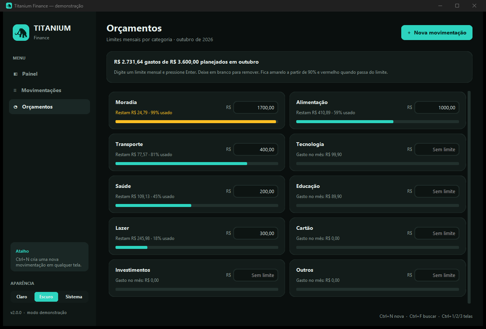
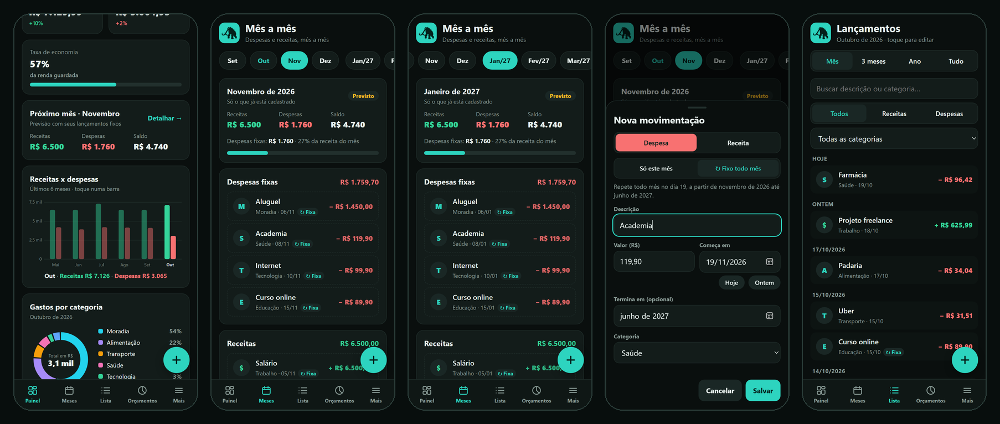

# 🏛️ Titanium Finance


O **Titanium** é um app desktop de controle financeiro pessoal feito em Python. Ele reúne em um só painel o saldo do período, as receitas e despesas, a evolução mês a mês, os gastos por categoria e os orçamentos, tudo 100% offline e salvo localmente em SQLite.



---

## 🚀 Funcionalidades

- 📊 **Painel (hub)** com 4 indicadores: saldo, receitas, despesas e taxa de economia. Cada um traz a variação em relação ao período anterior, comparando o mesmo trecho (1º a 19 de outubro contra 1º a 19 de setembro) para não distorcer.
- 📈 **Gráfico de receitas x despesas** dos últimos 6 ou 12 meses. Passe o mouse sobre uma barra para ver o valor.
- 🍩 **Gastos por categoria** em rosca, com legenda em porcentagem. Passe o mouse sobre uma fatia para destacá-la.
- 🗓️ **Períodos rápidos:** Mês, 3 meses, Ano ou Tudo. O período escolhido vale para o painel e para a lista.
- 📋 **Movimentações** em tabela com busca instantânea, filtros por tipo e categoria, ordenação por coluna e totais do que está filtrado.
- 🎯 **Orçamentos mensais** por categoria, com barra que fica amarela a partir de 90% e vermelha quando o limite estoura.
- ⚡ **Cadastro rápido:** valor aceita `150,50`, `150.50` ou `1.500`; data aceita `14/10`, `hoje` ou `ontem`; ao repetir uma descrição, o tipo e a categoria da última vez são preenchidos sozinhos.
- 📁 **Exportação CSV** pronta para o Excel em português (`;` e vírgula decimal).
- 🎨 **Tema claro, escuro ou do sistema**, e o app lembra suas preferências entre execuções.
- 🔁 **Migração automática:** na primeira execução, os dados do `financeiro.db` da versão 1.x são importados.
- ⌨️ **Atalhos:** `Ctrl+N` nova movimentação · `Ctrl+F` buscar · `Ctrl+1/2/3` trocar de tela · `Ctrl+E` exportar · `Delete` excluir · duplo clique para editar.
- 🖥️ **Modo terminal** para scripts e automações.
- 📱 **Versão mobile** instalável (PWA), com os mesmos dados em formato CSV.

| Tema claro | Nova movimentação |
|---|---|
|  |  |

| Movimentações | Orçamentos |
|---|---|
|  |  |

---

## 📦 Instalação

```bash
git clone https://github.com/Prequelunsainted/Controle-financeiro1.2.git
cd Controle-financeiro1.2
pip install -r requirements.txt
```

## ▶️ Como usar

Interface gráfica:

```bash
python -m titanium
```

Quer conhecer o app sem digitar nada? Abra com dados de exemplo. Eles ficam só na memória e não tocam nos seus dados:

```bash
python -m titanium --demo
```

> O antigo `python app.py` continua funcionando.

Terminal:

```bash
python -m titanium adicionar "Supermercado" 150,50 -c Alimentação
python -m titanium adicionar "Salário" 5.000 --receita -c Trabalho --data 05/10
python -m titanium listar --periodo mes
python -m titanium resumo --periodo ano
python -m titanium exportar relatorio.csv --periodo tudo
python -m titanium importar financeiro.db     # dados da versão 1.x
python -m titanium --help
```

Também é possível instalar como comando (`pip install .`) e rodar apenas `titanium`.

### Onde ficam os dados

| Sistema | Pasta |
|---|---|
| Windows | `%APPDATA%\Titanium\` |
| macOS | `~/Library/Application Support/Titanium/` |
| Linux | `~/.local/share/Titanium/` |

O banco é o `titanium.db` e as preferências ficam em `settings.json`. Para usar outro arquivo, passe `--db caminho.db` (ou defina a variável `TITANIUM_DB`).

## 📱 Versão mobile (Android e iPhone)

Na pasta [`mobile/`](mobile) há uma versão do Titanium para celular, feita como **PWA**: instala na tela inicial, abre em tela cheia, funciona offline e tem o mesmo visual do app de computador (painel, gráficos, lançamentos e orçamentos).



**Instalar:** abra **<https://prequelunsainted.github.io/Controle-financeiro1.2/mobile/>** no celular (ative antes em *Settings → Pages → Deploy from a branch → `main` / root*) e
- **Android (Chrome):** menu ⋮ → *Instalar app* (ou use o botão **Instalar app** da aba *Mais*);
- **iPhone (Safari):** botão Compartilhar → *Adicionar à Tela de Início*.

Recursos: botão **+** para lançar em segundos (data nativa do celular, categoria padrão por tipo e repetição do tipo e da categoria pela descrição), gráfico de barras com toque no mês, rosca de gastos por categoria, orçamentos com alertas, busca e filtros, tema claro/escuro/sistema e exportação em **CSV** e backup **JSON**.

**Fixo todo mês ou só este mês.** Ao lançar uma despesa ou receita, escolha entre *Só este mês* e *↻ Fixo todo mês*. O lançamento fixo é cadastrado uma vez só e se repete sozinho todo mês, no mesmo dia (no último dia do mês, quando o mês é mais curto), até o mês de término que você escolher (opcional). Editar ou excluir um fixo vale para todos os meses.

**Aba Meses (mês a mês).** Mostra, mês por mês, as receitas, as despesas e o saldo previstos, separando **despesas fixas**, **despesas avulsas** e **receitas**, e quanto da renda do mês as despesas fixas comprometem. O seletor de meses é calculado a partir da data de hoje: hoje mostra *Set, Out, Nov, Dez* e, na sequência, *Jan/27, Fev/27…* (vira o ano sozinho, sempre com os próximos 12 meses). O painel também traz um cartão com a previsão do próximo mês.

> Os dados ficam **só no aparelho** (armazenamento do navegador) e nunca são enviados a nenhum servidor. O CSV do celular e o do computador têm o mesmo formato (o do celular ganhou as colunas opcionais `Recorrência` e `Até`): use *Exportar* em um e *Importar* no outro para levar seus lançamentos de um lado para o outro.

Para testar no computador (ou conhecer com dados de exemplo, sem salvar nada):

```bash
python -m http.server 8000 --directory mobile
# abra http://localhost:8000  ou  http://localhost:8000/?demo
# (no modo demo: &page=Meses  &month=2026-11-01  &theme=dark  &sheet&fixo)
```

Testes do núcleo JavaScript (precisa do Node 18+; também rodam abrindo `mobile/tests.html` no navegador):

```bash
cd mobile
npm test
```

> Ao publicar uma nova versão, troque o número em `mobile/sw.js` (`CACHE`) para o celular baixar a atualização.

---

## 🏗️ Gerando o executável

```bash
pip install -r requirements.txt pyinstaller
python build_exe.py
```

O arquivo fica em `dist/Titanium.exe`.

---

## 🎨 Design

A interface foi desenhada antes no Figma, com variáveis de cor para os temas claro e escuro e componentes reutilizáveis (card de indicador, linha de movimentação, linha de orçamento e item de menu). O código usa exatamente as mesmas cores.

- Arquivo no Figma: [Hub no Figma](https://www.figma.com/design/hYQlEvC2TZuf26hcK3QDy2)

## 🗂️ Estrutura

```
titanium/
├── core.py        # regras: valores, datas, períodos, totais, orçamentos (sem interface, 100% testável)
├── storage.py     # SQLite: movimentações, orçamentos, importação da v1 e CSV
├── app.py         # interface gráfica (CustomTkinter)
├── charts.py      # gráficos Matplotlib embutidos, com dica ao passar o mouse
├── assets.py      # logo e ícone gerados a partir da silhueta do Titanium
├── settings.py    # preferências salvas entre execuções
├── demo.py        # dados de exemplo do modo --demo
├── __main__.py    # ponto de entrada e linha de comando
└── assets/titanium.png
mobile/            # versão PWA para Android e iPhone (core.js, store.js, app.js, sw.js...)
tests/             # testes automatizados (Python)
build_exe.py       # gera o Titanium.exe com PyInstaller
app.py             # atalho compatível com a versão 1.x
```

## ✅ Testes

```bash
python -m unittest discover -s tests -v
```

Os testes (Python e JavaScript) também rodam automaticamente no GitHub Actions a cada push.

---

## 🛠️ Tecnologias

- **[Python 3.10+](https://www.python.org/)**
- **[CustomTkinter](https://github.com/TomSchimansky/CustomTkinter):** interface gráfica moderna.
- **[Matplotlib](https://matplotlib.org/):** gráficos do painel.
- **[Pillow](https://python-pillow.org/):** logo e ícone.
- **SQLite:** banco de dados local, sem servidor.

## 📄 Licença

Distribuído sob a licença MIT. Veja [LICENSE](LICENSE).
